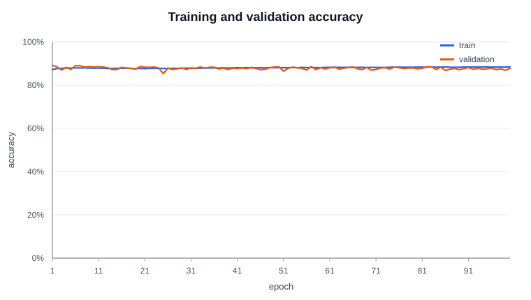

# DepositPropensityNet

A Multi-Layer Perceptron (MLP) binary classifier built from scratch in C# to predict whether a bank client will subscribe to a term deposit (`"yes"` vs `"no"`) based on direct marketing campaign data. It uses no external machine learning libraries—only the custom [`InputNeuron`](src/ML/InputNeuron.cs), [`HiddenNeuron`](src/ML/HiddenNeuron.cs), [`OutputNeuron`](src/ML/OutputNeuron.cs), and [`NeuralNetwork`](src/ML/NeuralNetwork.cs) classes in this repository.

## Built with

<div align="center">


</div>

## Data & ETL Pipeline

UCI Machine Learning Repository: [UCI Bank Marketing Dataset Page](https://archive.ics.uci.edu/dataset/222/bank+marketing)

- **`data/bank/bank-full.csv`**: **45,211 client records** (`39,922` `"no"` [88.30%] and `5,289` `"yes"` [11.70%]).
- **`data/bank/bank.csv`**: Official 10% subset (**4,521 records**). Not used for the reported results (all tuning and final runs use `bank-full.csv`), but handy for quick smoke tests.

### Preprocessing Steps (`src/ETL/`)
1. **CSV Parsing ([`Loader.cs`](src/ETL/Loader.cs))**: Parses semicolon-delimited (`;`) rows, skips the header, and strips double quotes.
2. **Data Leakage Prevention**: Drops column 12 (`duration`, call length in seconds) because call duration is only known *after* a call finishes and leaks the target outcome.
3. **Categorical & Numerical Encoding (47 Input Features)**:
   - **6 Continuous Numerical Features (`[0..5]`)**: `age`, `balance`, `day`, `campaign`, `pdays`, `previous`.
   - **3 Binary Features (`[6..8]`)**: `default`, `housing`, `loan` mapped to `1.0` (`"yes"`) and `0.0` (`"no"`).
   - **6 One-Hot Categorical Features (`[9..46]`, 38 columns)**: `job` (12), `marital` (3), `education` (4), `contact` (3), `month` (12), `poutcome` (4). Explicit `"unknown"` tokens are preserved as their own category so zero rows are lost.
   - **Binary Target (`y`)**: `"yes"` $\to 1$ (`1.0`), `"no"` $\to 0$ (`0.0`).
4. **80/20 Train/Test Split**: Deterministic Fisher-Yates shuffle (`seed = 1234`) splitting `bank-full.csv` into **36,168 training samples (80%)** and **9,043 testing/validation samples (20%)**.
5. **Leakage-Free MinMax Scaling ([`Normalizer.cs`](src/ETL/Normalizer.cs))**: Fits feature minimums and maximums strictly on the 80% training split, transforms continuous features to $[0, 1]$, clamps unseen test values to $[0, 1]$, and saves the scaler bounds to `weights/normalizer.txt`.

## Requirements

- [.NET 10 SDK](https://dotnet.microsoft.com/download)

## Run the trainer

From the project root folder:

```bash
dotnet run -c Release
```

To reproduce the final model on `bank-full.csv` (100 epochs, saving weights, metrics, and SVG charts):

```bash
dotnet run -c Release -- --data data/bank/bank-full.csv --hidden 32 --lr 0.05 --pos-weight 3.0 --epochs 100 --seed 1234
```

All CLI options (`dotnet run -- --help`):

| Option | Default | Meaning |
| --- | --- | --- |
| `--data <path>` | `data/bank/bank-full.csv` | Path to Bank Marketing CSV (`bank-full.csv` or `bank.csv`) |
| `--hidden <n>` | `32` | Number of hidden-layer neurons |
| `--lr <x>` | `0.05` | Output-layer learning rate ($\eta$) |
| `--hidden-lr <x>` | `0.05` | Hidden-layer learning rate |
| `--pos-weight <x>` | `1.0` | Positive class (`"yes"`) error weight for class imbalance |
| `--epochs <n>` | `100` | Number of training passes |
| `--patience <n>` | `0` (off) | Stop after `n` epochs without validation-loss improvement |
| `--log-interval <n>` | `100` | Print console loss every $n$ epochs |
| `--seed <n>` | `1234` | Deterministic seed for split, shuffling, and weight initialization |

## Run the interactive GUI

From the project root folder:

```bash
dotnet run --project src/GUI
```

The GUI is a separate Avalonia project in [`src/GUI/`](src/GUI/), so it uses `--project src/GUI`. It loads `weights/best.txt` and `weights/normalizer.txt` (run the trainer first), lets you enter a bank client's attributes, and press **Predict** to see the predicted outcome (`YES` / `NO`) and propensity score.

## Tuning

All tuning runs use the full `bank-full.csv` (45,211 rows, 80/20 split) with fixed epoch counts (`patience = 0`) and are recorded in [`logs/experiments.csv`](logs/experiments.csv) (63 runs).

**Method**
- Each configuration is run with **3 seeds (1234, 42, 7)**. The seed changes the train/test split, the weight initialization, and the shuffle order, so the spread reflects real run-to-run variation. Tables show the **mean across the 3 seeds** (± standard deviation for validation loss).
- Every run executes for the full specified number of epochs without early stopping (`--patience 0`). The reported evaluation metrics come from the checkpoint (`weights/best.txt`) with the lowest validation loss during the run.
- "Validation" here is the 20% test split, because the project uses a two-way split. Selecting settings and reporting results on the same split is optimistic. Treat the differences as indicative rather than as an unbiased estimate.

### 1. Hidden Layer Size (`lr = 0.05`, `pos-weight = 1.0`, `epochs = 100`)

| Hidden Nodes | Best Val Loss (± sd) | Accuracy | Precision (`yes`) | Recall (`yes`) | F1 (`yes`) | Best Epoch | Time |
| ---: | ---: | ---: | ---: | ---: | ---: | ---: | ---: |
| 1 | 0.04143 ± 0.00079 | 89.63% | 61.2% | 24.4% | 0.349 | 89 | 1s |
| 8 | 0.04060 ± 0.00066 | 89.62% | 61.7% | 22.8% | 0.332 | 79 | 4s |
| 16 | **0.04044 ± 0.00057** | 89.66% | 61.3% | 24.3% | 0.347 | 86 | 7s |
| **32** | 0.04055 ± 0.00049 | 89.60% | 61.1% | 23.8% | 0.342 | 71 | 13s |
| 64 | 0.04057 ± 0.00062 | 89.52% | 60.0% | 23.6% | 0.338 | 79 | 24s |
| 128 | 0.04065 ± 0.00064 | 89.64% | 60.6% | 25.3% | 0.356 | 75 | 47s |

### 2. Learning Rate $\eta$ (`hidden = 32`, `pos-weight = 1.0`, `epochs = 100`)

| Learning Rate | Best Val Loss (± sd) | Accuracy | F1 (`yes`) | Best Epoch |
| ---: | ---: | ---: | ---: | ---: |
| 0.01 | 0.04133 ± 0.00063 | 89.71% | 0.311 | 98 |
| 0.02 | 0.04079 ± 0.00056 | 89.71% | 0.321 | 92 |
| **0.05** | 0.04055 ± 0.00049 | 89.60% | 0.342 | 71 |
| 0.10 | **0.04052 ± 0.00056** | 89.56% | **0.346** | 47 |
| 0.20 | 0.04059 ± 0.00052 | 89.56% | 0.337 | 32 |
| 0.30 | 0.04055 ± 0.00055 | 89.61% | 0.337 | 26 |

### 3. Positive-Class Weight (`hidden = 32`, `lr = 0.05`, `epochs = 100`)

| Pos Weight | Best Val Loss (± sd) | Accuracy | Precision (`yes`) | Recall (`yes`) | F1 (`yes`) | Best Epoch |
| ---: | ---: | ---: | ---: | ---: | ---: | ---: |
| 1.0 | **0.04055 ± 0.00049** | 89.60% | 61.1% | 23.8% | 0.342 | 71 |
| 2.0 | 0.04118 ± 0.00009 | 89.41% | 56.8% | 32.0% | 0.406 | 62 |
| 2.5 | 0.04225 ± 0.00082 | 89.26% | 54.9% | 33.6% | 0.415 | 46 |
| **3.0** | 0.04360 ± 0.00144 | 89.07% | 52.9% | 35.0% | 0.421 | 17 |
| 4.0 | 0.04706 ± 0.00221 | 88.43% | 49.2% | 42.4% | **0.454** | 46 |

### 4. Fixed Epoch Count (`hidden = 32`, `lr = 0.05`)

| Epochs | Pos Weight | Best Val Loss (± sd) | Accuracy | Precision (`yes`) | Recall (`yes`) | F1 (`yes`) | Best Epoch | Time |
| ---: | ---: | ---: | ---: | ---: | ---: | ---: | ---: | ---: |
| 5 | 1.0 | 0.04173 ± 0.00071 | 89.63% | 65.0% | 19.4% | 0.298 | 4 | 1s |
| 10 | 1.0 | 0.04163 ± 0.00067 | 89.63% | 64.3% | 19.8% | 0.302 | 8 | 1s |
| 30 | 1.0 | 0.04109 ± 0.00062 | 89.73% | 65.1% | 21.2% | 0.318 | 29 | 4s |
| **100** | **1.0** | **0.04055 ± 0.00049** | **89.60%** | **61.1%** | **23.8%** | **0.342** | **71** | **13s** |
| 5 | 3.0 | 0.04558 ± 0.00045 | 89.11% | 53.5% | 32.6% | 0.405 | 2 | 1s |
| 10 | 3.0 | 0.04479 ± 0.00159 | 88.95% | 52.2% | 34.0% | 0.412 | 6 | 1s |
| 30 | 3.0 | 0.04468 ± 0.00146 | 88.91% | 51.7% | 36.2% | **0.425** | 11 | 4s |
| **100** | **3.0** | **0.04360 ± 0.00144** | **89.07%** | **52.9%** | **35.0%** | **0.421** | **17** | **12s** |

### Chosen Configuration: `hidden = 32`, `lr = 0.05`, `pos-weight = 3.0`, `epochs = 100`

- **Hidden size (32):** Sizes 8 to 128 are statistically tied. Their validation losses differ by at most about 0.0002, which is smaller than the seed-to-seed standard deviation of about 0.0006. Only a single hidden node is clearly worse (0.04143). Size 16 has the nominally lowest loss, but not by a meaningful margin. We kept 32 because the learning-rate and weight sweeps were run at 32, and it is about 2 to 3.5 times cheaper than 64 or 128 with no measurable loss in quality.
- **Learning rate (0.05):** Every rate from 0.05 to 0.30 gives the same validation loss within noise. Rates 0.01 and 0.02 do not finish converging within 100 epochs (best epoch 98 and 92, with higher validation loss 0.04133 and 0.04079). 0.05 is a stable middle choice.
- **Positive-class weight (3.0):** This is a trade-off, not a free improvement. Raising the weight increases `yes` recall and F1 (recall 23.8% → 35.0%, F1 0.342 → 0.421 versus unweighted) but lowers precision (61.1% → 52.9%) and accuracy (89.60% → 89.07%), and best validation loss gets worse because the model predicts `yes` more often. At weight 4.0, accuracy (88.43%) drops down to the majority-class `"no"` baseline (~88.3%), so we stopped at 3.0.
- **Fixed epochs (100):** Short runs (`5`, `10`, `30` epochs) underfit on validation loss (0.04173 → 0.04109 vs 0.04055 at 100 epochs for unweighted, and 0.04558 → 0.04468 vs 0.04360 at 100 epochs for `pos-weight = 3.0`). Running for 100 epochs ensures the network passes through its best validation checkpoint (mean epoch 71 unweighted, 17 weighted).

## Results

Final settings: **32 hidden neurons, lr 0.05, hidden-lr 0.05, seed 1234, 100 epochs** (`36,168` training rows, `9,043` test rows).

### Unweighted Baseline (`pos-weight = 1.0`, [`logs/train-h32-lr0.05-hlr0.05-e100-s1234.csv`](logs/train-h32-lr0.05-hlr0.05-e100-s1234.csv))

| Epoch | Train loss | Train accuracy | Val loss | Val accuracy |
| ---: | ---: | ---: | ---: | ---: |
| 1 | 0.04642 | 88.67% | 0.04213 | 89.58% |
| 10 | 0.04339 | 89.14% | 0.04149 | 89.66% |
| 20 | 0.04312 | 89.21% | 0.04128 | 89.75% |
| 30 | 0.04268 | 89.32% | 0.04073 | 89.83% |
| 40 | 0.04222 | 89.38% | 0.04041 | 89.81% |
| 50 | 0.04181 | 89.47% | 0.04046 | 89.78% |
| 60 | 0.04148 | 89.50% | 0.04056 | 89.53% |
| 70 | 0.04120 | 89.48% | 0.04048 | 89.47% |
| 80 | 0.04093 | 89.65% | 0.04055 | 89.53% |
| 90 | 0.04070 | 89.57% | 0.04049 | 89.56% |
| 100 | **0.04048** | **89.67%** | **0.04039** | 89.67% |

### Chosen Weighted Model (`pos-weight = 3.0`, [`logs/train-h32-lr0.05-hlr0.05-pw3-e100-s1234.csv`](logs/train-h32-lr0.05-hlr0.05-pw3-e100-s1234.csv))

| Epoch | Train loss | Train accuracy | Val loss | Val accuracy |
| ---: | ---: | ---: | ---: | ---: |
| 1 | 0.05647 | 87.16% | 0.04533 | 89.13% |
| 10 | 0.05310 | 87.82% | 0.05024 | 88.41% |
| 20 | 0.05176 | 87.69% | 0.04475 | 88.58% |
| 30 | 0.05084 | 87.86% | 0.05237 | 87.28% |
| 40 | 0.05030 | 87.95% | 0.05016 | 87.78% |
| 50 | 0.04974 | 88.07% | 0.04510 | 88.51% |
| 60 | 0.04949 | 88.17% | 0.05345 | 87.48% |
| 70 | 0.04934 | 88.20% | 0.05682 | 86.89% |
| 80 | 0.04904 | 88.33% | 0.05120 | 87.49% |
| 90 | 0.04896 | 88.38% | 0.05344 | 87.63% |
| 100 | **0.04869** | **88.46%** | 0.05091 | 87.75% |

- **Training loss decreases steadily across all 100 epochs** in both runs (unweighted `0.04642` → `0.04048`, weighted `0.05647` → `0.04869`), while training accuracy climbs (`88.67%` → `89.67%` unweighted, `87.16%` → `88.46%` weighted).
- **Best validation checkpoint (`weights/best.txt`):** Validation loss reaches its minimum at epoch 45 (`0.04028`) for the unweighted model and epoch 6 (`0.04302`) for the weighted model (`pos-weight = 3.0`), after which the network begins fitting the training set more closely.




### Test Set Evaluation (best checkpoint, 9,043 samples)

| Configuration | Best Epoch | Accuracy | Precision (`yes`) | Recall (`yes`) | F1 (`yes`) | TN / FP / FN / TP |
| --- | ---: | ---: | ---: | ---: | ---: | --- |
| Unweighted (`pos-weight = 1.0`) | 45 | 89.75% | 62.57% | 22.47% | 0.331 | 7,887 / 137 / 790 / 229 |
| **Chosen (`pos-weight = 3.0`)** | 6 | 89.03% | 52.11% | 32.78% | 0.402 | 7,717 / 307 / 685 / 334 |

Per-class metrics for the chosen configuration:

| Class | Precision | Recall | F1 Score | Support |
| --- | ---: | ---: | ---: | ---: |
| `no (0)` | 0.918 | 0.962 | 0.940 | 8,024 |
| `yes (1)` | 0.521 | 0.328 | 0.402 | 1,019 |
| **Macro Avg** | **0.720** | **0.645** | **0.671** | **9,043** |


**Variation across seeds** (mean ± sd over seeds 1234, 42, 7 at 100 epochs, from [`logs/experiments.csv`](logs/experiments.csv)):

| Configuration | Accuracy | Precision (`yes`) | Recall (`yes`) | F1 (`yes`) |
| --- | ---: | ---: | ---: | ---: |
| Unweighted (`pos-weight = 1.0`) | 89.60% ± 0.20% | 61.1% ± 2.8% | 23.8% ± 1.9% | 0.342 ± 0.022 |
| `pos-weight = 3.0` | 89.07% ± 0.09% | 52.9% ± 3.4% | 35.0% ± 2.7% | 0.421 ± 0.029 |

The seed-1234 run is slightly below the 3-seed mean for the weighted model (F1 0.402 vs 0.421), which is within about one standard deviation.

**Analysis**
- Only about 11.3% of test clients subscribe, so always predicting `no` scores about 88.7% accuracy with 0% recall. Both models beat that baseline on accuracy only slightly (89.0% to 89.8%), so accuracy is not the informative metric here.
- What matters is the `yes` class. Among clients the weighted model flags as `yes`, 52.1% actually subscribe, about 4.6 times the 11.3% base rate. It finds 32.8% of all real subscribers, versus 22.5% for the unweighted model, at the cost of 170 more false positives (307 vs 137).
- The model uses only pre-call information (`duration` is dropped to avoid leakage), so its ability to rank clients is modest. This is a lead-prioritization tool, not a reliable per-client predictor.

## File Structure

| Path | Purpose |
| --- | --- |
| [`Program.cs`](Program.cs) | CLI entry point, training loop, evaluation, and CSV/SVG logging |
| [`src/ETL/Loader.cs`](src/ETL/Loader.cs) | Semicolon CSV parser, `duration` drop, 47-feature encoder, and 80/20 split |
| [`src/ETL/Normalizer.cs`](src/ETL/Normalizer.cs) | Leakage-free MinMax $[0, 1]$ normalizer for continuous numerical features |
| [`src/ML/InputNeuron.cs`](src/ML/InputNeuron.cs) | Input-layer neuron storing feature value and input-to-hidden weights |
| [`src/ML/HiddenNeuron.cs`](src/ML/HiddenNeuron.cs) | Hidden-layer neuron with sigmoid activation, bias, delta, and output weights |
| [`src/ML/OutputNeuron.cs`](src/ML/OutputNeuron.cs) | Output-layer neuron producing sigmoid subscription probability |
| [`src/ML/NeuralNetwork.cs`](src/ML/NeuralNetwork.cs) | Multi-Layer Perceptron forward pass, MSE loss, backpropagation, and weight persistence |
| [`src/ML/TrainingConfig.cs`](src/ML/TrainingConfig.cs) | Reproducible command-line hyperparameter configuration parser |
| [`src/ML/Metrics.cs`](src/ML/Metrics.cs) | Binary classification Accuracy, Precision, Recall, F1, and 2×2 confusion matrix |
| [`src/ML/ChartWriter.cs`](src/ML/ChartWriter.cs) | Dependency-free SVG line chart and confusion matrix renderer |
| [`src/GUI/`](src/GUI/) | Avalonia predictor app (`MainWindow.cs`, `App.cs`, `Program.cs`) |
| [`logs/`](logs/) | Epoch training CSV logs, [`experiments.csv`](logs/experiments.csv), and SVG charts |
| [`weights/`](weights/) | Saved model checkpoints (`best.txt`, `last.txt`) and fitted `normalizer.txt` |

## License

Distributed under the MIT License. See [`LICENSE`](LICENSE) for more information.
