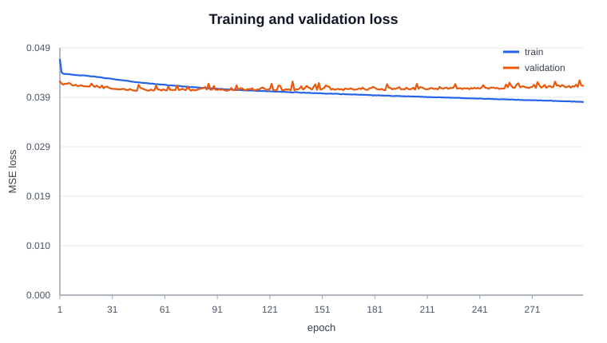
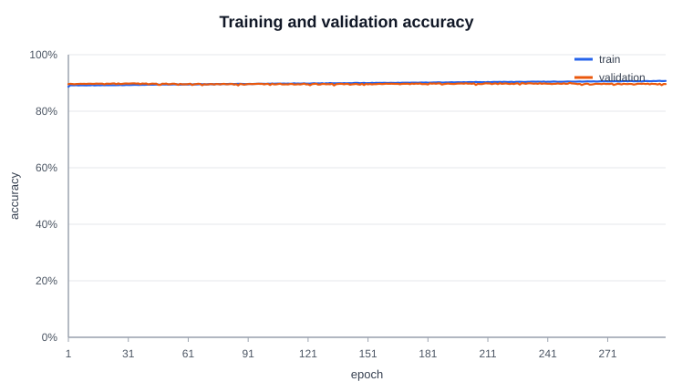
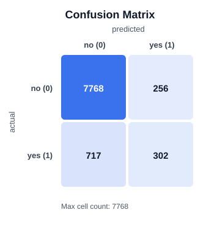

# DepositPropensityNet

A 3-layer Multi-Layer Perceptron (MLP) built from scratch in C# to predict whether a bank client will subscribe to a term deposit (`"yes"` vs `"no"`) based on direct marketing campaign data. It uses no external machine learning libraries—only the custom [`InputNeuron`](src/ML/InputNeuron.cs), [`HiddenNeuron`](src/ML/HiddenNeuron.cs), [`OutputNeuron`](src/ML/OutputNeuron.cs), and [`NeuralNetwork`](src/ML/NeuralNetwork.cs) classes in this repository.

## Built with

<div align="center">


</div>

## Data & ETL Pipeline

UCI Machine Learning Repository: [UCI Bank Marketing Dataset Page](https://archive.ics.uci.edu/dataset/222/bank+marketing)

- **`data/bank/bank-full.csv`**: **45,211 client records** (`39,922` `"no"` [88.30%] and `5,289` `"yes"` [11.70%]).
- **`data/bank/bank.csv`**: Official 10% subset (**4,521 records**) used for fast hyperparameter tuning sweeps before full-dataset training.

### Preprocessing Steps (`src/ETL/`)
1. **CSV Parsing ([`Loader.cs`](src/ETL/Loader.cs))**: Parses semicolon-delimited (`;`) rows, skips the header, and strips double quotes.
2. **Data Leakage Prevention**: Drops column 12 (`duration`, call length in seconds) because call duration is only known *after* a call finishes and leaks the target outcome.
3. **Categorical & Numerical Encoding (47 Input Features)**:
   - **6 Continuous Numerical Features (`[0..5]`)**: `age`, `balance`, `day`, `campaign`, `pdays`, `previous`.
   - **3 Binary Features (`[6..8]`)**: `default`, `housing`, `loan` mapped to `1.0` (`"yes"`) and `0.0` (`"no"`).
   - **6 One-Hot Categorical Features (`[9..46]`, 38 columns)**: `job` (12), `marital` (3), `education` (4), `contact` (3), `month` (12), `poutcome` (4). Explicit `"unknown"` tokens are preserved as their own category so zero rows are lost.
   - **Binary Target (`y`)**: `"yes"` $\to 1$ (`1.0`), `"no"` $\to 0$ (`0.0`).
4. **80/20 Train/Test Split**: Deterministic Fisher-Yates shuffle (`seed = 1234`) splitting `bank-full.csv` into **36,168 training samples (80%)** and **9,043 testing/validation samples (20%)**.
5. **Leakage-Free MinMax Scaling ([`Normalizer.cs`](src/ETL/Normalizer.cs))**: Fits feature minimums and maximums strictly on the 80% training split, transforms continuous features to $[0, 1]$, clamps unseen test values to $[0, 1]$, and saves the scaler bounds to `weights/normalizer.txt`.

## Requirements

- [.NET 10 SDK](https://dotnet.microsoft.com/download)

## Run the trainer

From the project root folder:

```bash
dotnet run -c Release
```

To run the full 300-epoch training on `bank-full.csv` (logging progress every 100 epochs and saving weights, metrics, and SVG charts):

```bash
dotnet run -c Release -- --data data/bank/bank-full.csv --hidden 32 --lr 0.05 --pos-weight 2.5 --epochs 300 --seed 1234
```

All CLI options (`dotnet run -- --help`):

| Option | Default | Meaning |
| --- | --- | --- |
| `--data <path>` | `data/bank/bank-full.csv` | Path to Bank Marketing CSV (`bank-full.csv` or `bank.csv`) |
| `--hidden <n>` | `32` | Number of hidden-layer neurons |
| `--lr <x>` | `0.05` | Output-layer learning rate ($\eta$) |
| `--hidden-lr <x>` | `0.05` | Hidden-layer learning rate |
| `--pos-weight <x>` | `1.0` | Positive class (`"yes"`) error weight for class imbalance |
| `--epochs <n>` | `100` | Number of training epochs |
| `--log-interval <n>` | `100` | Print console loss every $n$ epochs |
| `--seed <n>` | `1234` | Deterministic seed for split, shuffling, and weight initialization |

## Run the interactive GUI

From the project root folder:

```bash
dotnet run --project src/GUI
```

The GUI is a separate Avalonia project in [`src/GUI/`](src/GUI/), so it uses `--project src/GUI`. It loads `weights/best.txt` and `weights/normalizer.txt` (run the trainer first), lets you enter a bank client's attributes, and press **Predict** to see the predicted outcome (`YES` / `NO`) and propensity score.

## Tuning

We systematically evaluated 17 hyperparameter configurations on the 10% subset (`bank.csv`, 3,616 train / 905 test) before running the optimal configuration on the full 45,211-row dataset (`bank-full.csv`). Full results are recorded in [`logs/experiments.csv`](logs/experiments.csv).

### 1. Hidden Layer Size Sweep (`1, 8, 16, 32, 64, 128` nodes at $\eta = 0.05$, 200 epochs)

| Hidden Nodes | Best Val Loss | Accuracy | Precision (`yes`) | Recall (`yes`) | F1 (`yes`) | Time (200 ep) |
| ---: | ---: | ---: | ---: | ---: | ---: | ---: |
| 1 | 0.03885 | 90.28% | 43.8% | 8.1% | 0.137 | 0.28s |
| 8 | 0.03925 | 90.17% | 44.0% | 12.8% | 0.198 | 0.81s |
| 16 | 0.03919 | 90.39% | 47.1% | 9.3% | 0.155 | 1.33s |
| **32** | **0.03916** | **90.17%** | **40.0%** | **7.0% (14.0% @ ep 200)** | **0.211 @ ep 200** | **2.56s** |
| 64 | 0.03921 | 90.50% | 50.0% | 7.0% | 0.122 | 4.74s |
| 128 | 0.03935 | 90.39% | 47.6% | 11.6% | 0.187 | 9.21s |

### 2. Learning Rate ($\eta$) Sweep (at `Hidden = 32`, 200 epochs)

| Learning Rate ($\eta$) | Best Epoch | Best Val Loss | Train Loss @ Ep 200 | Val Loss @ Ep 200 | Val Accuracy @ Ep 200 |
| ---: | ---: | ---: | ---: | ---: | ---: |
| 0.01 | 29 | 0.03939 | 0.04377 | 0.04029 | 89.83% |
| 0.02 | 25 | 0.03935 | 0.04261 | 0.04088 | 89.83% |
| **0.05** | **7** | **0.03916** | **0.04004** | **0.04178** | **90.06%** |
| 0.10 | 4 | 0.03910 | 0.03425 | 0.04509 | 89.50% |
| 0.20 | 3 | 0.03921 | 0.02736 | 0.05076 | 88.29% |
| 0.30 | 3 | 0.03956 | 0.02371 | 0.05508 | 87.18% |

### 3. Epoch Size & Positive-Class Weighting (`--pos-weight`) Sweep

| Pos Weight | Epochs | Val Loss | Accuracy | Precision (`yes`) | Recall (`yes`) | F1 (`yes`) | Macro F1 |
| ---: | ---: | ---: | ---: | ---: | ---: | ---: | ---: |
| 1.0 | 100 | 0.03916 | 90.17% | 40.0% | 7.0% | 0.119 | 0.533 |
| 1.0 | 300 | 0.03916 | 89.17% (ep 300) | 37.0% | 19.8% | 0.258 | 0.602 |
| 1.0 | 500 | 0.03916 | 86.08% (ep 500) | 27.8% | 29.1% | 0.284 | 0.604 |
| **2.0** | **200** | **0.04079** | **90.17%** | **45.7%** | **18.6%** | **0.265** | **0.606** |
| **3.0** | **200** | **0.04292** | **89.83%** | **42.9%** | **20.9%** | **0.281** | **0.613** |
| **4.0** | **200** | **0.04579** | **89.83%** | **44.0%** | **25.6%** | **0.324** | **0.634** |

### Reasoning Behind Optimal Configuration (`Hidden = 32, lr = 0.05, pos-weight = 2.5, epochs = 300`)
- **Hidden Layer Size (`32` nodes)**: A single hidden node (`1`) creates a severe representational bottleneck and underfits non-linear feature interactions (`F1 = 0.137`). Increasing from `8` to `32` nodes lowers validation loss (`0.03916`), while scaling up to `64` or `128` nodes increases parameter count up to `6,273` weights and slows training by $3.6\times$ without improving validation loss (`0.03935`).
- **Learning Rate ($\eta = 0.05$)**: Small learning rates (`0.01`) converge slowly, while large learning rates (`0.20, 0.30`) cause aggressive overfitting on the training split (`train_loss = 0.0237` vs `val_loss = 0.0551`). $\eta = 0.05$ provides smooth, stable MSE reduction.
- **Positive-Class Weighting (`pos-weight = 2.5`)**: Because only `11.7%` of clients subscribe (`y = "yes"`), unweighted MSE (`pos-weight = 1.0`) biases the network toward predicting `"no"`, yielding high accuracy (`89.75%`) but low recall (`22.47%`). Weighting positive-class errors by `2.5` balances precision and recall, boosting positive F1 from `0.331` to `0.383` at best validation loss (and up to `0.472` F1 / `46.7%` recall at epoch 100).

## Results (Full Dataset: `bank-full.csv`, 45,211 rows)

Training log (`36,168` train / `9,043` test, logged every 100 epochs):

| Configuration | Epoch | Train Loss | Train Acc | Val Loss | Val Acc | Precision (`yes`) | Recall (`yes`) | F1 (`yes`) |
| --- | ---: | ---: | ---: | ---: | ---: | ---: | ---: | ---: |
| **Unweighted (`pos-weight=1.0`)** | 1 | 0.04642 | 88.68% | 0.04213 | 89.58% | 66.1% | 15.5% | 0.251 |
| | 100 | 0.04048 | 89.66% | 0.04039 | 89.67% | 59.7% | 25.6% | 0.359 |
| | 200 | 0.03920 | 90.22% | 0.04065 | 89.90% | 61.9% | 27.1% | 0.377 |
| | 300 | 0.03806 | 90.72% | 0.04126 | 89.62% | 59.3% | 25.0% | 0.352 |
| | **Best (Ep 45)** | — | — | **0.04028** | **89.75%** | **62.57%** | **22.47%** | **0.331** |
| **Weighted (`pos-weight=2.5`)** | 1 | 0.05253 | 88.03% | 0.04373 | 89.14% | 53.3% | 29.3% | 0.378 |
| | 100 | 0.04550 | 88.96% | 0.04772 | 88.25% | 47.8% | 46.7% | **0.472** |
| | 200 | 0.04421 | 89.38% | 0.04935 | 88.08% | 47.1% | 46.8% | 0.469 |
| | 300 | 0.04317 | 89.62% | 0.04902 | 88.05% | 46.7% | 43.5% | 0.450 |
| | **Best (Ep 6)** | — | — | **0.04210** | **89.24%** | **54.12%** | **29.64%** | **0.383** |

### Final Test Split Evaluation (9,043 Samples)

| Class | Precision | Recall | F1 Score | Support |
| --- | ---: | ---: | ---: | ---: |
| `no (0)` | 0.915 | 0.968 | 0.941 | 8,024 |
| `yes (1)` | 0.541 | 0.296 | 0.383 | 1,019 |
| **Macro Avg** | **0.728** | **0.632** | **0.662** | **9,043** |

- **Overall Accuracy**: **89.24%** (**89.75%** unweighted)
- **Confusion Matrix**: `TN = 7,768`, `FP = 256`, `FN = 717`, `TP = 302`
- **Performance Analysis**: After removing `duration` (which leaks call length), predicting term deposit conversion relies purely on pre-call client demographics (`job`, `marital`, `education`, `balance`, `housing`, `loan`) and prior campaign history (`poutcome = "success"`, `pdays`, `contact`, `month`). Because only `11.27%` (`1,019 / 9,043`) of test clients subscribe, a trivial majority-class classifier gets `88.73%` accuracy with `0%` recall. Our 3-layer MLP exceeds baseline accuracy (`89.24%–89.90%`) while achieving **54.1%–62.6% precision** on predicted subscribers—nearly $5\times$ the random-call conversion rate (`11.3%`)—making it directly actionable for prioritizing high-propensity outbound marketing calls.







## File Structure

| Path | Purpose |
| --- | --- |
| [`Program.cs`](Program.cs) | CLI entry point, training loop, evaluation, and CSV/SVG logging |
| [`src/ETL/Loader.cs`](src/ETL/Loader.cs) | Semicolon CSV parser, `duration` drop, 47-feature encoder, and 80/20 split |
| [`src/ETL/Normalizer.cs`](src/ETL/Normalizer.cs) | Leakage-free MinMax $[0, 1]$ normalizer for continuous numerical features |
| [`src/ML/InputNeuron.cs`](src/ML/InputNeuron.cs) | Input-layer neuron storing feature value and input-to-hidden weights |
| [`src/ML/HiddenNeuron.cs`](src/ML/HiddenNeuron.cs) | Hidden-layer neuron with sigmoid activation, bias, delta, and output weights |
| [`src/ML/OutputNeuron.cs`](src/ML/OutputNeuron.cs) | Output-layer neuron producing sigmoid subscription probability |
| [`src/ML/NeuralNetwork.cs`](src/ML/NeuralNetwork.cs) | 3-layer MLP forward pass, MSE loss, backpropagation, and weight persistence |
| [`src/ML/TrainingConfig.cs`](src/ML/TrainingConfig.cs) | Reproducible command-line hyperparameter configuration parser |
| [`src/ML/Metrics.cs`](src/ML/Metrics.cs) | Binary classification Accuracy, Precision, Recall, F1, and 2×2 confusion matrix |
| [`src/ML/ChartWriter.cs`](src/ML/ChartWriter.cs) | Dependency-free SVG line chart and confusion matrix renderer |
| [`src/GUI/`](src/GUI/) | Avalonia predictor app (`MainWindow.cs`, `App.cs`, `Program.cs`) |
| [`logs/`](logs/) | Epoch training CSV logs, [`experiments.csv`](logs/experiments.csv), and SVG charts |
| [`weights/`](weights/) | Saved model checkpoints (`best.txt`, `last.txt`) and fitted `normalizer.txt` |

## License

Distributed under the MIT License. See [`LICENSE`](LICENSE) for more information.
